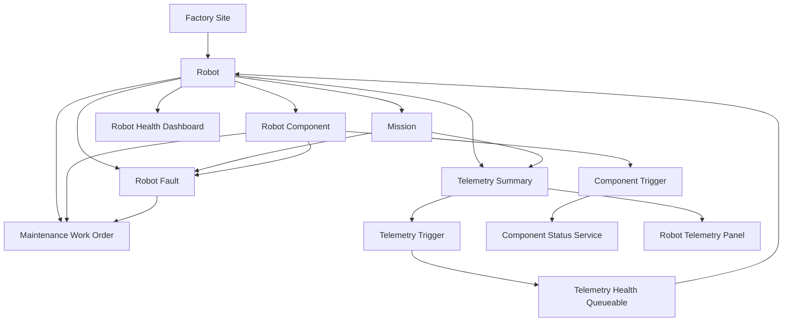

# Robotika — Salesforce Robot Operations Platform

Robotika is a Salesforce application for monitoring industrial robots, processing telemetry, managing faults, scheduling maintenance, and supporting technicians through automated workflows.

The project demonstrates source-driven Salesforce development using custom objects, Flow, Apex, Lightning Web Components, reports, dashboards, permissions, integrations, asynchronous processing, and automated tests.

## Core Capabilities

- Manage factory sites, robots, components, missions, telemetry, faults, and maintenance work orders.
- Calculate component condition from operating hours and expected service life.
- Update robot health and operational status from telemetry.
- Automatically create emergency work orders for critical faults.
- Resolve linked faults when maintenance work is completed.
- Remind assigned technicians about upcoming maintenance.
- Provide a guided technician screen flow.
- Display robot health and telemetry through custom Lightning Web Components.
- Call an external robot diagnostics service.
- Provide operational reports and a management dashboard.
- Restrict technicians through a least-privilege permission set.

## Architecture



## Data Model

### Factory Site

Stores the manufacturing facility where robots operate.

Important fields include:

- Site Code
- Site Type
- Country
- Operational Status
- Operations Manager

### Robot

Represents an industrial robot deployed at a factory site.

Important fields include:

- Robot Name
- Robot Serial Number
- Robot Type
- Robot Model
- Firmware Version
- Operational Status
- Health Score
- Installation Date
- Last Service Date
- Next Service Date
- Total Operating Hours
- Total Components

### Robot Component

Represents a physical component installed in a robot.

Important fields include:

- Component Number
- Component Serial Number
- Component Type
- Manufacturer
- Installation Date
- Expected Service Life Hours
- Current Operating Hours
- Service Life Remaining
- Component Status

Robot Component has a master-detail relationship with Robot.

### Mission

Represents a task performed by a robot.

Important fields include:

- External Mission ID
- Mission Type
- Mission Status
- Start Time
- End Time
- Duration Hours
- Robot

### Telemetry Summary

Stores summarized robot telemetry readings.

Important fields include:

- Robot
- Mission
- Recorded At
- Telemetry Status
- Battery Level
- CPU Utilization
- CPU Temperature
- Average Motor Temperature
- Network Latency
- Active Fault Count
- Requires Attention

### Robot Fault

Represents an operational fault detected on a robot or component.

Important fields include:

- External Fault ID
- Fault Code
- Fault Description
- Severity
- Fault Status
- Detected At
- Resolved At
- Resolution Hours
- Resolution Notes
- Robot
- Robot Component
- Mission

### Maintenance Work Order

Represents scheduled or emergency robot maintenance.

Important fields include:

- Work Order Number
- Robot
- Robot Component
- Robot Fault
- Assigned Technician
- Work Order Status
- Priority
- Maintenance Type
- Scheduled Start and End
- Actual Start and End
- Actual Duration Hours
- Labor Cost
- Parts Cost
- Total Cost
- Work Performed
- Reminder Sent

Maintenance Work Order has a master-detail relationship with Robot and uses sharing controlled by its parent robot.

## Salesforce Flow Automation

### Create Work Order for Critical Fault

A record-triggered flow that creates an emergency maintenance work order when a new critical robot fault is detected.

The generated work order is connected to:

- The affected robot
- The affected component, when provided
- The triggering robot fault

### Resolve Fault When Work Order Completed

A record-triggered flow that updates the linked robot fault when its maintenance work order is completed.

The automation records the resolution status and completion time while respecting the validation rule that prevents a resolution time earlier than the detection time.

### Update Robot Status from Telemetry

A record-triggered flow that updates a robot’s operational status when telemetry requires attention.

Possible operational states include:

- Degraded
- Maintenance Required
- Unavailable

### Create Scheduled Maintenance Reminders

A schedule-triggered flow that creates reminder tasks for assigned technicians when maintenance is scheduled within the next 24 hours.

It also marks the work order to prevent duplicate reminders.

### Technician Maintenance Assistant

A screen flow launched from a Maintenance Work Order.

It allows a technician to:

- Review work-order information
- Start maintenance
- Complete maintenance
- Record actual timestamps
- Update work performed and applicable costs

## Apex Services

### RobotHealthService

Provides robot health data to Lightning components.

Features include:

- Configurable health-score threshold
- Operational-status filtering
- Input validation
- Cacheable Aura-enabled method
- Sharing enforcement

### RobotTelemetryService

Provides recent telemetry records for a selected robot.

Features include:

- Aura-enabled access for Lightning Web Components
- User-mode data access
- Ordered telemetry results
- Record-limit validation

### RobotIngestionService

Supports programmatic insertion and updating of robot records.

Features include:

- Serial-number-based matching
- Insert and update behavior
- Duplicate detection
- Partial-success processing
- Input validation
- Bulk-safe DML handling

### RobotComponentStatusService

Calculates component status from current operating hours and expected service life.

The service is invoked by `RobotComponentTrigger` during insert and update operations.

The implementation is bulk-safe and does not perform SOQL or DML inside loops.

### TelemetryHealthQueueable

Processes telemetry asynchronously and updates robot health scores.

The queueable service:

- Handles multiple telemetry records
- Selects the most serious calculated health result
- Supports normal and critical telemetry
- Safely handles empty and null input

It is launched by `TelemetrySummaryTrigger`.

### RobotDiagnosticsClient

The current endpoint uses the reserved `api.robotika.example` domain as a non-production placeholder. Unit tests use `HttpCalloutMock`, so no external request is made during testing. A production implementation should replace this endpoint with a Salesforce Named Credential.

Calls an external robot diagnostics service.

The implementation includes:

- HTTP callout handling
- JSON deserialization
- Required-data validation
- HTTP failure handling
- Invalid-response handling
- Mock-based unit tests

### RobotikaTestDataFactory

Creates reusable test records for Apex tests and reduces duplicated test setup.

## Lightning Web Components

### Robot Health Dashboard

`robotHealthDashboard` displays robots needing operational attention.

Features include:

- Adjustable maximum health-score threshold
- Robot status and health display
- Health progress indicators
- Component counts
- Refresh action
- Empty and error states

The component is available on the Robotika application home page.

### Robot Telemetry Panel

`robotTelemetryPanel` displays recent telemetry on a Robot record page.

Features include:

- Latest telemetry status
- Battery and CPU utilization
- Active fault count
- CPU and motor temperature
- Network latency
- Telemetry history
- Refresh action
- Empty and error states

Salesforce Percent fields are handled as whole percentage values in the JavaScript presentation layer.

## Security

The `Robotika_Technician` permission set follows least-privilege principles.

### Object access

Technicians receive read access to:

- Factory Sites
- Robots
- Robot Components
- Missions
- Telemetry Summaries
- Robot Faults

Technicians receive read and edit access to Maintenance Work Orders, without create or delete access.

### Editable maintenance fields

Technicians can edit only:

- Actual Start
- Actual End
- Labor Cost
- Parts Cost
- Work Order Status
- Work Performed

### Additional access

The permission set includes:

- Access to `RobotHealthService`
- Access to `RobotTelemetryService`
- Access to the Technician Maintenance Assistant flow
- Run Flow permission
- Availability of the seven Robotika custom-object tabs

The permission set was tested with a restricted technician user.

## Reports

The project includes four operational reports:

1. **Robots Needing Attention**
   - Identifies robots with low health scores or problematic operational statuses.

2. **Open Robot Faults by Severity**
   - Groups unresolved faults by severity and robot.

3. **Maintenance Work Orders by Status and Priority**
   - Summarizes maintenance activity by status and priority.

4. **Components Approaching Service Limit**
   - Identifies components that have reached a warning or maintenance condition.

## Dashboard

The **Robotika Operations Dashboard** provides a consolidated view of:

- Robots needing attention
- Open robot faults by severity
- Maintenance work orders by status and priority
- Components approaching their service limit

## Project Structure

```text
force-app/main/default/
├── classes/
├── dashboards/
├── flexipages/
├── flows/
├── layouts/
├── lwc/
├── objects/
├── permissionsets/
├── reports/
├── tabs/
└── triggers/
```

## Prerequisites

Install:

- Salesforce CLI
- Node.js and npm
- VS Code with the Salesforce Extension Pack
- Access to a Salesforce Developer Edition, sandbox, or scratch org

## Authorize an Org

```bash
sf org login web --alias RobotikaDev
```

Confirm the authorized org:

```bash
sf org display --target-org RobotikaDev
```

## Install JavaScript Dependencies

```bash
npm install
```

## Deploy the Project

```bash
sf project deploy start \
  --target-org RobotikaDev \
  --source-dir force-app \
  --test-level RunLocalTests \
  --wait 20
```

## Run Apex Tests

```bash
sf apex run test \
  --target-org RobotikaDev \
  --test-level RunLocalTests \
  --code-coverage \
  --result-format human \
  --wait 20
```

Latest verified result:

- 30 Apex tests passed
- 0 failures
- 98% org-wide Apex coverage

## Run Lightning Web Component Tests

```bash
npm run test:unit
```

Latest verified result:

- 2 Jest test suites passed
- 10 tests passed
- 0 failures

Standard Jest execution is used because coverage mode can be unreliable or unusually slow with some `sfdx-lwc-jest` environments.

## Quality Practices Demonstrated

- Source-driven Salesforce DX development
- Bulk-safe Apex
- Trigger-handler separation
- Asynchronous Queueable Apex
- HTTP callouts and mocks
- Reusable test-data factory
- Positive and negative unit tests
- User-mode queries and sharing enforcement
- Declarative automation with Flow
- Formula, validation, and roll-up summary fields
- Lightning Web Components with Jest tests
- Least-privilege permission design
- Reports and operational dashboards
- Metadata retrieval and deployment through Salesforce CLI

## Example Business Scenario

Atlas One is a humanoid robot operating at a manufacturing site.

When component operating hours approach expected service life:

1. The component is updated.
2. `RobotComponentTrigger` invokes `RobotComponentStatusService`.
3. The component status becomes Warning.
4. The service-limit report includes the component.
5. The operations dashboard displays the maintenance risk.

When critical telemetry or a fault occurs:

1. Telemetry updates robot health asynchronously.
2. Automation changes the robot’s operational status.
3. A critical fault creates an emergency work order.
4. A technician performs maintenance through the guided screen flow.
5. Completing the work order resolves the connected fault.

## License

This project is intended as a Salesforce development portfolio and certification-learning project.